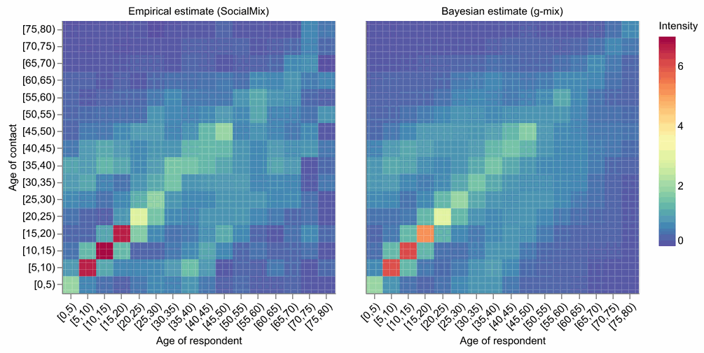

<h1 align="center">cntmosaic</h1>

<p align="center">
  <b>Estimate social contact matrices from contact survey data in Python,<br>
  from classical estimators to Bayesian models of generalised contact matrices.</b>
</p>

<p align="center">
  <a href="https://github.com/MLGlobalHealth/cntmosaic/actions"></a>
  <a href="https://codecov.io/gh/ShozenD/cntmosaic"></a>
  <a href="https://cntmosaic-docs.readthedocs.io/en/latest/"></a>
  <a href="https://github.com/MLGlobalHealth/cntmosaic"></a>
  <a href="LICENSE"></a>
  <a href="https://arxiv.org/abs/2605.06742"></a>
</p>

<p align="center">
  <a href="https://cntmosaic-docs.readthedocs.io/en/latest/">Documentation</a> ·
  <a href="https://cntmosaic-docs.readthedocs.io/en/latest/tutorials/index.html">Tutorials</a> ·
  <a href="#installation">Installation</a> ·
  <a href="#citing-cntmosaic">Citing</a>
</p>

---

## What is cntmosaic?

A **social contact matrix** gives the average number of contacts that people in one group have with people in another group, most often by age. Contact matrices are a key input to models of infectious disease transmission: they determine who infects whom, and therefore quantities such as the basic reproduction number $R_0$ and the effect of interventions such as school closures. They are usually estimated from **contact surveys** such as POLYMOD, in which respondents record the contacts they had on a given day.

Estimating contact matrices well is difficult. Surveys can be small relative to the number of age-by-age cells, data preprocessing is tedious, and implementing models for generalised contact matrices is an intricate, time-consuming process. `cntmosaic` (read: contact mosaic) therefore brings all the necessary machinery together in one unifying Python package, and covers the workflow from data preparation to inference and visualisation.

<p align="center">
  
  <br>
  <sub>Contact intensity by age of respondent and age of contact for the POLYMOD UK survey: the empirical estimate of <code>SocialMix</code> (left) and the Bayesian estimate of g-mix with the van de Kassteele prior, which also enforces reciprocity (right).</sub>
</p>

### Features

- **Several estimators with one data interface.** Fit the same data with a classical estimator or a Bayesian model and compare them (see [Estimation methods](#estimation-methods)).
- **Generalised contact matrices.** Stratify contacts by age and further characteristics such as sex or socioeconomic status, and predict fully stratified matrices when the characteristics of contacts are not observed.
- **Coarse and fine age resolution.** Estimate single-year contact matrices when the ages of contacts are recorded only in age groups, or work at age-group resolution throughout.
- **Uncertainty quantification.** Bootstrap intervals for the classical estimator, and full posterior inference by MCMC (NUTS) or variational inference built on [NumPyro](https://num.pyro.ai) and [JAX](https://jax.readthedocs.io), on CPU or GPU.
- **Survey weights.** Day-of-week, post-stratification, design and category weights for the classical estimator, with diagnostics and truncation.
- **Data and tools.** Validated data containers, the POLYMOD UK and Germany surveys shipped with the package, synthetic survey simulation, model comparison by cross-validation, and contact matrix plots built on [Altair](https://altair-viz.github.io).

### Estimation methods

| Method                                                                                       | Classes                                         | What it estimates                                                                              |
|----------------------------------------------------------------------------------------------|-------------------------------------------------|------------------------------------------------------------------------------------------------|
| socialmixr estimator ([Funk et al.](https://github.com/epiforecasts/socialmixr))             | `SocialMix`                                     | Empirical contact matrices with reciprocity adjustment, survey weights and bootstrap intervals |
| Prem et al. ([2017](https://doi.org/10.1371/journal.pcbi.1005697))                           | `Prem`, `Prem2`                                 | Smoothed contact matrices with an intrinsic Gaussian Markov random field prior                 |
| van de Kassteele et al. ([2017](https://doi.org/10.1214/16-AOAS1006))                        | `vdKassteele`, `vdKassteele2D` prior            | Smoothed contact matrices with a Gaussian Markov random field prior on the contact rates       |
| Bayesian rate consistency ([Dan et al., 2023](https://doi.org/10.1371/journal.pcbi.1011191)) | `AgeMixFF`, `AgeMixFC`, `AgeMixCC`              | Single-year contact matrices from coarse age data, consistent with the population              |
| g-mix ([Dan et al., 2026](https://arxiv.org/abs/2605.06742))                                 | `GenMixFF`, `GenMixFC`, `GenMixCC`, `Predictor` | Generalised contact matrices, including prediction from partially stratified data              |

> **Note:** `cntmosaic` is in active development (version 0.6). The API may change before the 1.0 release.

---

## Quick example

Estimate an age-stratified contact matrix from the POLYMOD UK survey, which is shipped with the package, and quantify its uncertainty with the bootstrap:

```python
from cntmosaic.datasets import load_polymod_uk
from cntmosaic.dataloader import ContactData, ParticipantData, PopulationData
from cntmosaic.models import SocialMix
from cntmosaic.utils import AgeGroupSpecs
from cntmosaic.vis import plot_mosaic_pixilated

# POLYMOD UK survey (Mossong et al., 2008) and the 2011 UK census, shipped with cntmosaic
survey = load_polymod_uk()
contacts = survey["contacts"].rename(columns={"cnt_age_exact": "cnt_age"})
population = survey["population"].groupby("age", as_index=False)["P"].sum()

sm = SocialMix(
    part_data=ParticipantData(survey["participants"], id_col="part_id", age_col="part_age"),
    cnt_data=ContactData(contacts, id_col="part_id", age_col="cnt_age"),
    age_group_specs=AgeGroupSpecs(0, 79, 5),  # 5-year age groups
    pop_data=PopulationData(population, age_col="age", size_col="P"),
    apply_reciprocity=True,
)

m = sm.cint()["All->All"]                                       # contact intensity matrix
boot = sm.run_inference_bootstrap(n_boot=1000, random_state=1)  # bootstrap uncertainty
plot_mosaic_pixilated(m, zlabel="Intensity")
```

The Bayesian models use the same data containers. The [tutorials](#tutorials) show each estimator in full.

---

## Installation

`cntmosaic` is not yet on PyPI. Install it from source; Python 3.10–3.12 are tested.

```bash
git clone https://github.com/MLGlobalHealth/cntmosaic.git
cd cntmosaic
python -m venv .venv
source .venv/bin/activate        # on Windows: .venv\Scripts\activate
pip install -e .
```

Check the installation:

```bash
python -c "import cntmosaic; print(cntmosaic.__version__)"
```

The Bayesian models run on CPU by default. To use an NVIDIA GPU, install JAX with CUDA support, e.g. `pip install --upgrade "jax[cuda12]"` (see the [JAX installation guide](https://jax.readthedocs.io/en/latest/installation.html)).

---

## Tutorials

The tutorials are Jupyter notebooks, rendered with their outputs in the [documentation](https://cntmosaic-docs.readthedocs.io/en/latest/tutorials/index.html). Each can also be opened in Google Colab.

| Tutorial                                                                                                                          | Description                                                                                                                               |                                                                                                                                                                                                                     |
|-----------------------------------------------------------------------------------------------------------------------------------|-------------------------------------------------------------------------------------------------------------------------------------------|---------------------------------------------------------------------------------------------------------------------------------------------------------------------------------------------------------------------|
| [00 — Quickstart](https://cntmosaic-docs.readthedocs.io/en/latest/tutorials/00_Quickstart.html)                                   | A complete workflow on the POLYMOD Germany survey: load the data, fit a Bayesian contact model, and plot the posterior contact matrix.    | [](https://colab.research.google.com/github/MLGlobalHealth/cntmosaic/blob/main/docs/source/tutorials/00_Quickstart.ipynb)                 |
| [01 — Generalised contact matrices](https://cntmosaic-docs.readthedocs.io/en/latest/tutorials/01_Tutorial_GenMix.html)            | Contact matrices stratified by age and gender with g-mix, with complete and partial observation of the contacts' gender.                  | [](https://colab.research.google.com/github/MLGlobalHealth/cntmosaic/blob/main/docs/source/tutorials/01_Tutorial_GenMix.ipynb)            |
| [02 — SocialMix](https://cntmosaic-docs.readthedocs.io/en/latest/tutorials/02_Tutorial_SocialMix.html)                            | Empirical contact matrices: bootstrap, reciprocity, contact rates, filtering and stratification.                                          | [](https://colab.research.google.com/github/MLGlobalHealth/cntmosaic/blob/main/docs/source/tutorials/02_Tutorial_SocialMix.ipynb)         |
| [03 — Context-specific contact matrices](https://cntmosaic-docs.readthedocs.io/en/latest/tutorials/03_Tutorial_Prem_Context.html) | Home, school, work and other contact matrices for the UK with `Prem2`.                                                                    | [](https://colab.research.google.com/github/MLGlobalHealth/cntmosaic/blob/main/docs/source/tutorials/03_Tutorial_Prem_Context.ipynb)      |
| [04 — Feature selection](https://cntmosaic-docs.readthedocs.io/en/latest/tutorials/04_Tutorial_Feature_Selection.html)            | Choose the stratification variables of a contact model by cross-validation.                                                               | [](https://colab.research.google.com/github/MLGlobalHealth/cntmosaic/blob/main/docs/source/tutorials/04_Tutorial_Feature_Selection.ipynb) |
| [05 — Survey weights](https://cntmosaic-docs.readthedocs.io/en/latest/tutorials/05_Tutorial_SocialMix_Weights.html)               | Respondent weights in `SocialMix`: day-of-week, post-stratification, design and category weights, diagnostics and the weighted bootstrap. | [](https://colab.research.google.com/github/MLGlobalHealth/cntmosaic/blob/main/docs/source/tutorials/05_Tutorial_SocialMix_Weights.ipynb) |

---

## Citing cntmosaic

If you use `cntmosaic` in your research, please cite:

> Dan, S., van Dyk, D. A., Ling, Z., Mishra, S., & Ratmann, O. (2026).
> Bayesian Modeling and Prediction of Generalized Contact Matrices.
> *arXiv preprint* arXiv:2605.06742. https://doi.org/10.48550/arXiv.2605.06742

```bibtex
@misc{dan2026bayesian,
  title         = {Bayesian Modeling and Prediction of Generalized Contact Matrices},
  author        = {Shozen Dan and David A. van Dyk and Zhi Ling and Swapnil Mishra and Oliver Ratmann},
  year          = {2026},
  eprint        = {2605.06742},
  archivePrefix = {arXiv},
  primaryClass  = {stat.ME},
  doi           = {10.48550/arXiv.2605.06742},
  url           = {https://arxiv.org/abs/2605.06742}
}
```

**If you use any of the estimation methods, please also cite the methodological work in which it was introduced:**

| Method                    | `cntmosaic` classes                             | Please cite                                                                                                                                                                                                                                                                                                                           |
|---------------------------|-------------------------------------------------|---------------------------------------------------------------------------------------------------------------------------------------------------------------------------------------------------------------------------------------------------------------------------------------------------------------------------------------|
| socialmixr estimator      | `SocialMix`                                     | Funk, S., Willem, L., Gruson, H., & Tierney, N. *socialmixr: Social Mixing Matrices for Infectious Disease Modelling*. R package. https://github.com/epiforecasts/socialmixr                                                                                                                                                          |
| Prem et al.               | `Prem`, `Prem2`                                 | Prem, K., Cook, A. R., & Jit, M. (2017). Projecting social contact matrices in 152 countries using contact surveys and demographic data. *PLOS Computational Biology*, 13(9), e1005697. https://doi.org/10.1371/journal.pcbi.1005697                                                                                                  |
| van de Kassteele et al.   | `vdKassteele`, `vdKassteele2D`                  | van de Kassteele, J., van Eijkeren, J., & Wallinga, J. (2017). Efficient estimation of age-specific social contact rates between men and women. *The Annals of Applied Statistics*, 11(1), 320–339. https://doi.org/10.1214/16-AOAS1006                                                                                               |
| Bayesian rate consistency | `AgeMixFF`, `AgeMixFC`, `AgeMixCC`              | Dan, S., Chen, Y., Chen, Y., Monod, M., Jaeger, V. K., Bhatt, S., Karch, A., & Ratmann, O. (2023). Estimating fine age structure and time trends in human contact patterns from coarse contact data: The Bayesian rate consistency model. *PLOS Computational Biology*, 19(6), e1011191. https://doi.org/10.1371/journal.pcbi.1011191 |
| g-mix                     | `GenMixFF`, `GenMixFC`, `GenMixCC`, `Predictor` | Dan, S., van Dyk, D. A., Ling, Z., Mishra, S., & Ratmann, O. (2026), cited above.                                                                                                                                                                                                                                                     |

If you use the POLYMOD data shipped with `cntmosaic`, please also cite:

> Mossong, J., Hens, N., Jit, M., Beutels, P., Auranen, K., Mikolajczyk, R., et al. (2008). Social contacts and mixing patterns relevant to the spread of infectious diseases. *PLoS Medicine*, 5(3), e74. https://doi.org/10.1371/journal.pmed.0050074

<details>
<summary>BibTeX for the methods and data</summary>

```bibtex
@manual{funk_socialmixr,
  title  = {socialmixr: Social Mixing Matrices for Infectious Disease Modelling},
  author = {Sebastian Funk and Lander Willem and Hugo Gruson and Nicholas Tierney},
  note   = {R package},
  url    = {https://github.com/epiforecasts/socialmixr}
}

@article{prem2017projecting,
  title   = {Projecting social contact matrices in 152 countries using contact surveys and demographic data},
  author  = {Kiesha Prem and Alex R. Cook and Mark Jit},
  journal = {PLOS Computational Biology},
  year    = {2017},
  volume  = {13},
  number  = {9},
  pages   = {e1005697},
  doi     = {10.1371/journal.pcbi.1005697}
}

@article{vandekassteele2017efficient,
  title   = {Efficient estimation of age-specific social contact rates between men and women},
  author  = {Jan van de Kassteele and Jan van Eijkeren and Jacco Wallinga},
  journal = {The Annals of Applied Statistics},
  year    = {2017},
  volume  = {11},
  number  = {1},
  pages   = {320--339},
  doi     = {10.1214/16-AOAS1006}
}

@article{dan2023estimating,
  title   = {Estimating fine age structure and time trends in human contact patterns from coarse contact data: The {B}ayesian rate consistency model},
  author  = {Shozen Dan and Yu Chen and Yining Chen and Melodie Monod and Veronika K. Jaeger and Samir Bhatt and Andr{\'e} Karch and Oliver Ratmann},
  journal = {PLOS Computational Biology},
  year    = {2023},
  volume  = {19},
  number  = {6},
  pages   = {e1011191},
  doi     = {10.1371/journal.pcbi.1011191}
}

@article{mossong2008social,
  title   = {Social contacts and mixing patterns relevant to the spread of infectious diseases},
  author  = {Jo{\"e}l Mossong and Niel Hens and Mark Jit and Philippe Beutels and Kari Auranen and Rafael Mikolajczyk and Marco Massari and Stefania Salmaso and Gianpaolo Scalia Tomba and Jacco Wallinga and Janneke Heijne and Malgorzata Sadkowska-Todys and Magdalena Rosinska and W. John Edmunds},
  journal = {PLoS Medicine},
  year    = {2008},
  volume  = {5},
  number  = {3},
  pages   = {e74},
  doi     = {10.1371/journal.pmed.0050074}
}
```

</details>

---

## Contributing

Bug reports, feature requests and questions are welcome. Please read [CONTRIBUTING.md](CONTRIBUTING.md), or open an issue:

- [Report a bug](https://github.com/MLGlobalHealth/cntmosaic/issues/new?template=bug_report.yml)
- [Request a feature](https://github.com/MLGlobalHealth/cntmosaic/issues/new?template=feature_request.yml)

## License

`cntmosaic` is released under the [BSD 3-Clause License](LICENSE). Copyright © 2026, Imperial College London.

## Acknowledgements

`cntmosaic` is co-developed by a community of research groups working on social contact data, including:

- the [Machine Learning & Global Health network](https://github.com/MLGlobalHealth), Imperial College London (United Kingdom);
- ISI Foundation (Italy);
- Hasselt University (Belgium);
- National University of Singapore (Singapore).

`cntmosaic` builds on [JAX](https://jax.readthedocs.io), [NumPyro](https://num.pyro.ai), [ArviZ](https://python.arviz.org) and [Altair](https://altair-viz.github.io), and its `SocialMix` estimator follows the R package [socialmixr](https://github.com/epiforecasts/socialmixr).
