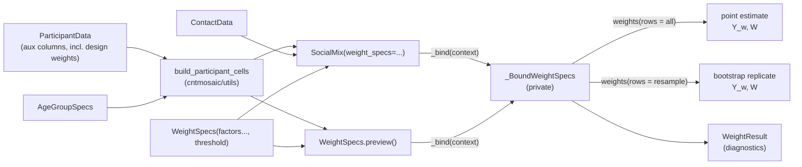

# Dev Docs - Survey Weights

**Date**: November 10, 2026
**Author**: Shozen Dan
**Status**: Implemented: every checklist item is done (2026-11-10)
**Branch**: `socialmix-survey-weights-ext`
**Target release**: 0.6.0

---

This document plans how participant weighting is added to `cntmosaic`. The aim is to cover everything socialmixr offers (day-of-week weights, age post-stratification, the general `weigh()`), without its pitfalls. It records the decisions made so far, the design of the weighting classes, the order of implementation, and the tests. It also covers the existing `SocialMix` bugs that must be fixed first.

**What socialmixr does** is described in the tutorial [`tutorials/05_Tutorial_SocialMix_Weights.ipynb`](../../tutorials/05_Tutorial_SocialMix_Weights.ipynb), which covers socialmixr 0.6.0.9000 at commit `b0d7134`. This document does not repeat that material; it refers to the notebook's sections by name. The notation is the notebook's (Section 0 there):
- $i$ participants; $a, b$ single-year ages; $c, d$ age groups; $\mathcal{N}_c$ the participants in age group $c$;
- $y_{id}$ contacts of participant $i$ in age group $d$;
- $\tilde w_i$ composite weight, $w_i$ normalised weight, $f^{(k)}_i$ the $k$-th factor.

Here, "cell" means the participant cell that `SocialMix` estimates over: age group $c$, crossed with the participant strata if there are any. The notebook's $\mathcal{N}_c$ is the special case without strata.

**The weighting unit is a row of the participant table.** With repeated measures (`part_repeat`), a row is a participant-day. All counts ($n_g$, $n_a$, $n_c$) count rows, and the bootstrap resamples rows, not persons.

## 1. Decision log

**Decided** means agreed with the user; **Proposed** means it is in this document but has not been confirmed yet.

| ID | Decision | Status | Date |
|----|----------|--------|------|
| D1 | Weighting is **opt-in**. The unweighted estimate is the default, and weighted and unweighted estimates must be easy to compare. | Decided | 2026-11-10 |
| D2 | **Architecture: a weighting specification passed to the estimator** (option "C/D hybrid"). Weights that depend on the sample (day of week, age post-stratification, target shares) are configured as factor objects in a `WeightSpecs` passed to `SocialMix(weight_specs=...)`. The estimator applies them to whatever sample it sees: the full sample, or each bootstrap replicate. | Decided | 2026-11-10 |
| D3 | **Design weights** that come with the survey are an ordinary auxiliary column of `ParticipantData` (`aux_cols`), applied only through `DesignWeights(col)` (D10). Revised by D15: there is no dedicated `weight_col`. | Decided | 2026-11-10 |
| D4 | **No thin functional helpers** such as `weigh_by_dayofweek(df) -> df`. The factor classes are the only public interface. | Decided | 2026-11-10 |
| D5 | **Do not copy the `weigh_by_age()` top-band bug** (notebook Section 5). Participants are never dropped silently. | Decided | 2026-11-10 |
| D6 | **Spell out the factor-versus-total meaning.** socialmixr infers it from the type of `target` (data frame vs vector); here it is a property of the class (`CategoryWeights` vs `PostStratWeights`). **Both classes accept either a dict or a `DataFrame`** as their table. User docs must explain when to use which (see *Which factor should I use?*). | Decided | 2026-11-10 |
| D7 | **Unmatched keys raise by default.** socialmixr gives an `NA` weight with a warning, which can turn the whole matrix `NA`. | Decided | 2026-11-10 |
| D8 | **The ratio estimator divides by the sum of weights.** `SocialMix` computes $m_{cd} = \sum_{i} w_i y_{id} / \sum_{i} w_i$ per cell, instead of the current $\sum_{i} w_i y_{id} / n_c$. Normalisation then only matters for truncation and diagnostics. | Decided | 2026-11-10 |
| D9 | **Bayesian models are out of scope for this development cycle.** This weighting is for the design-based `SocialMix` estimator only. A possible later counterpart is day of week as a covariate or stratum, then post-stratifying the posterior. | Decided | 2026-11-10 |
| D10 | **Design weights are applied only when the `WeightSpecs` includes `DesignWeights(col)`.** `weight_specs=` is the single switch, so the same `ParticipantData` gives both the unweighted and the weighted fit. (Resolves former Q1.) | Decided | 2026-11-10 |
| D11 | **`within="sample"` is the default** for `PostStratWeights` and `AgePostStratWeights` (as socialmixr). **`within="cell"` is also implemented** in v1. (Resolves former Q3; amended by D29 for `DayOfWeekWeights`.) | Decided | 2026-11-10 |
| D12 | **Names:** `WeightSpecs` (the specification/configuration), `DesignWeights`, `DayOfWeekWeights`, `AgePostStratWeights`. | Decided | 2026-11-10 |
| D13 | **Names for the two general factors:** `CategoryWeights` (fixed factor per category; was `Lookup`) and `PostStratWeights` (target share / sample share per category; was `GroupTotal`). `PostStratWeights`, `DayOfWeekWeights` and `AgePostStratWeights` share one private post-stratification base class. | Decided | 2026-11-10 |
| D14 | **The `SocialMix` argument is `weight_specs=`**, mirroring the existing `age_group_specs=`. | Decided | 2026-11-10 |
| D15 | **`weight_col` is removed entirely**, together with everything built on it. This covers `ParticipantData(weight_col=...)` and its validation, `normalize_weights()` / `check_weights_normalized()`, `SocialMix(normalise_weights=...)`, and the weighting in the Bayesian data path: `DataFrameSurveySource`, `ContactSurveyLoader`, and `build_contact_counts(weight_col=...)`. Design weights become an `aux_cols` column (D3). Nothing in the tests, tutorials or docs uses `weight_col`. (Also resolves former Q6.) | Decided | 2026-11-10 |
| D16 | **Subpackage name: `cntmosaic.weights`.** (Resolves former Q10.) | Decided | 2026-11-10 |
| D17 | **Normalise within the estimator's cells** (age group × participant strata), not by age group only as socialmixr does. Without truncation this gives the same estimate as socialmixr. (Resolves former Q2.) | Decided | 2026-11-10 |
| D18 | **Truncation: cap at $\tau$, then re-normalise once**, as socialmixr does. Weights may end up slightly above $\tau$. (Resolves former Q4.) | Decided | 2026-11-10 |
| D19 | **No rounding** when `AgePostStratWeights` spreads a banded population over single years. socialmixr 0.6 rounds. (Resolves former Q5.) *Note 2026-11-12:* socialmixr 0.7 no longer interpolates at all. `weigh_by_age()` weights at the population's own bands and has no effect when they are the matrix's age groups (`socialmixr_issues.md`, S2). | Decided | 2026-11-10 |
| D20 | **`SocialMix.from_dataframes()` takes an explicit `aux_cols`** argument; those columns are excluded from automatic stratum detection. (Resolves former Q7.) | Decided | 2026-11-10 |
| D21 | **Implement `WeightSpecs.preview()` in v1:** inspect the weights without fitting `SocialMix`. Its cells must match the fit exactly (see *`WeightSpecs.preview()`*). (Resolves former Q9.) | Decided | 2026-11-10 |
| D22 | **Fix the stratum-index bug as a separate step before the weights work** (Problem 7), with its own tests and a release-note entry. | Decided | 2026-11-10 |
| D23 | **Participants whose age lies outside `age_group_specs` are dropped**, with one warning giving the count. This applies everywhere: point estimate, bootstrap, weights and `preview()` (Problem 8). | Decided | 2026-11-10 |
| D24 | **Adaptive merging stops rebuilding the data containers.** It reassigns the age-group column on a copy of the data, so `part_age`, `aux_cols`, `part_repeat` and the ambiguous-count column survive (Problem 9). | Decided | 2026-11-10 |
| D25 | **A merge at bootstrap time rebinds the weights.** `SocialMix` rebinds, refreshes `sm.weights`, clears the weighted and unweighted `cint`/`rate` caches, and emits a `WeightWarning` that `sm.weights` has changed. `preview()` mirrors `fit()`, not the bootstrap-time merge. (Problem 10.) | Decided | 2026-11-10 |
| D26 | **Release as 0.6.0**, with release notes covering the breaking changes and a migration example for `weight_col`. | Decided | 2026-11-10 |
| D27 | **`Prem2` gets no weighting.** It must keep working (regression test), so the weight logic lives in `SocialMix`, not in the `SocialMixDataLoader` that `Prem2` shares. `Prem2.from_dataframes` keeps its current stratum detection. | Decided | 2026-11-10 |
| D28 | **Clean removal of `weight_col`: no tailored error message.** Passing `weight_col=` gives Python's ordinary `TypeError` for an unknown argument. The migration is described in the release notes only (D26). | Decided | 2026-11-10 |
| D29 | **`DayOfWeekWeights` defaults to `within="cell"`** (amends D11). The 5:2 calendar ratio holds within every age group, and sample-wide factors push age groups whose day mix deviates from the sample's further from 5:2 (tutorial 06, Section 3). `PostStratWeights` and `AgePostStratWeights` keep `"sample"`: a single target need not hold within every age group (e.g. a national sex ratio). | Decided | 2026-11-11 |
| D30 | **A cell that lacks a group warns.** With `within="cell"`, a cell with known values but no participants in a group with a positive target cannot meet the target mix: the observed factors are constant in the cell and cancel. Bind emits a `WeightWarning` naming the cells (full sample only; resamples are silent). Not for `AgePostStratWeights`, whose cells always lack most single years. | Decided | 2026-11-11 |
| D31 | **Post-stratification shares are taken among known values**: $f_i = (t_g/T)/(n_g/n)$ with $n$ the number of participants with a known value (per cell with `"cell"`). The known factors average 1, so `on_missing="average"` really gives the average factor. Departs from socialmixr, whose missing-day factor $7/N$ lies below the mean known factor $7/(N - \lvert\mathcal{M}\rvert)$. | Decided | 2026-11-11 |

## 2. Current state in cntmosaic

**Former weight support (removed on 2026-11-10, D15):**
- `ParticipantData(weight_col=...)` accepts a precomputed weight. It is renamed to `part_weight`, and the container checks it is strictly positive.
- `ParticipantData.normalize_weights(grp_cols)` rescales weights so they sum to the cell size; this is the notebook's normalisation step.
- `SocialMix(normalise_weights=...)` and `DataFrameSurveySource` call that rescaling. `Prem2` sets `normalise_weights = False` so it can reuse the SocialMix loader.
- `build_contact_counts(weight_col=...)` in `_observation.py` multiplies `y` by the weight. `ContactSurveyLoader` uses it and warns that weighted `y` is not suitable for count likelihoods.

**Problems found (2026-11-10); the fix for each is in brackets:**
1. **Wrong scale by default.** `SocialMix.cint()` computes `Y / N`, where `N` is the unweighted participant count. Because `normalise_weights=False` is the default, raw weights give $m_{cd}$ multiplied by the mean weight in the cell. [D8]
2. **The bootstrap ignores weights.** `_socialmix_bootstrap.py` never reads `part_weight`, so a weighted point estimate gets unweighted intervals. [Weights rebuilt in every replicate.]
3. **In-place mutation.** `normalize_weights()` rescales the user's `ParticipantData`, which changes it for every later consumer. [D15; normalisation moves into `WeightSpecs`.]
4. **Weights reach the Bayesian models.** Any `part_weight` column is applied automatically by `ContactSurveyLoader`; it only warns. [D9, D15]
5. **No place for weighting variables.** `ParticipantData` keeps only the columns it is told about (`df[required_cols].dropna()` in `_participant_preprocessing.py`). A `dayofweek` column is therefore dropped unless it is declared as a stratification variable, which would wrongly make it a matrix dimension. Rows with a missing value in a declared column are dropped too, whereas socialmixr gives a missing day the average weight. [`aux_cols`]
6. **`SocialMix.from_dataframes()`** treats every extra `part_*` column as a stratification variable. The same problem as 5. [D20]

**Found in the design review (2026-11-10). These are bugs in today's `SocialMix`, independent of weights:**

7. **The stratum index order is inconsistent.** With two or more participant stratification variables, results end up under the wrong stratum labels. [D22]
   - The point estimate builds its stratum index with the **first variable least significant**, and takes each dimension from `nunique()` (`_socialmix_utils.py` `_create_composite_index`; `_SocialMix.py` `strat_dims_part`).
   - The labels (`itertools.product` in `_socialmix_helpers.py`) and the bootstrap (`np.ravel_multi_index` over `len(categories)`) treat the **first variable as most significant**.
   - Example (sex × region): a stratum's point estimate is labelled `"F_B->All"` in `sm.cint()` but `"M_A->All"` in `boot.mean()`.
   - Unused categories make `nunique()` smaller than `len(categories)`, so composite indices can also collide.
8. **Participants outside `age_group_specs`.** `pd.cut` gives them a NaN age group, but they stay in `part_data`. [D23]
   - They are excluded from `N` but still drawn by the bootstrap.
   - There, a code of −1 makes every replicate fail, and the catch-all handler misreports this as "insufficient sample sizes".
9. **Adaptive merging deletes columns.** The validator rebuilds `ParticipantData` and `ContactData` with only `id`, the age group and the strata (`_socialmix_validation.py`, three merge sites), so `part_age`, `part_repeat` and any other column are lost. [D24]
10. **Merging can happen at bootstrap time.** `run_inference_bootstrap` re-runs the validator with `validate_for_bootstrap=True`, which can merge further age groups, and then reloads. Anything derived from the old cells is then stale. This merge for bootstrap stability (`_adaptive_merge_for_stability`) runs **even when `adaptive_merge=False`**; only the empty-group merge respects the flag. So D25 is a common case, not a corner case. [D25]
11. **`SocialMix` writes into the user's container.** It stores `part_age_grp` in `part_data.data`, and `_assign_age_groups` skips re-binning when that column exists. A second fit with different `age_group_specs` on the same `ParticipantData` silently reuses the old groups. [`build_participant_cells` works on a copy and always re-bins.]
12. **The bootstrap swallows errors.** A catch-all `except Exception` around each replicate turns any bug into a "failed replicate". Replicates are dropped silently as long as the success rate stays at or above `min_success_rate`. [Weights are evaluated outside the `try`; narrowing the `except` is part of the bootstrap step.]
13. **Contact-only stratification crashes.** With contact strata but no participant strata (mixed mode with $K_{\text{part}} = 1$), `SocialMix.cint()` indexes the 1-D `N` as `N[k_part, :]` and raises `IndexError`. Found while implementing D22; it is present on the original code. [Not yet scheduled; outside the weights work.]

## 3. Architecture overview



- **The data containers stay raw.** They carry the variables needed for weighting (including any design-weight column), never computed or normalised weights. Nothing writes back into the user's containers (Problem 11).
- **A `WeightSpecs` is pure configuration.** It holds no data, so one object can be reused across surveys, subsets and models.
- **One source of cells.** `build_participant_cells` is the only code that turns participants into cells; it covers age binning, out-of-range dropping (D23), adaptive merging (D24) and stratum codes (D22). The point estimate, the bootstrap, the weights and `preview()` all use it, so they cannot disagree.
- **The estimator binds the weighting to its own sample and its own cells.** Weights are therefore always computed after filtering, age grouping and adaptive merging, which avoids the "frozen at the wrong sample" failures.

**Location:**
- `cntmosaic/weights/` (`_factor.py`, `_factors.py`, `_poststrat.py`, `_specs.py`, `_result.py`, `_table.py`, `_warnings.py`), exported as `cntmosaic.weights` (D16). Add `weights` to `cntmosaic/__init__.py` and its `__all__`, and add an API page `docs/source/api/weights.rst`.
- `build_participant_cells` and the merge logic it needs go in a neutral module, `cntmosaic/utils/_participant_cells.py`. `SocialMixValidator` calls it. This avoids an import cycle, since `weights.preview()` needs the cells and `models.classical` imports `weights`.
- `weights` is not placed under `models/classical/`, because a later pseudo-likelihood could reuse it.

**Python version.** The sketches use PEP 604/585 syntax (`X | None`, `tuple[...]`). Implementation modules start with `from __future__ import annotations` and avoid runtime `X | Y`. Separately, `pyproject.toml` says `requires-python = ">=3.8"`, but the code base already uses `str.removeprefix` (3.9+); fixing that mismatch is a separate issue.

## 4. Design of `WeightSpecs` and the factors

### Intended use

```python
from cntmosaic.weights import (
    WeightSpecs, DesignWeights, CategoryWeights, PostStratWeights,
    DayOfWeekWeights, AgePostStratWeights,
)

part = ParticipantData(
    df_part, id_col="part_id", age_col="part_age",
    aux_cols=["dayofweek", "country", "region", "design_w"],  # new: kept for weighting, not stratified
)

weight_specs = WeightSpecs(
    DayOfWeekWeights("dayofweek"),                                   # 5 : 2, POLYMOD day coding
    AgePostStratWeights(pop_data),                                   # single-year age within cells
    PostStratWeights("country", {"UK": 0.3, "DE": 0.4, "IT": 0.3}),  # target country mix (dict)
    CategoryWeights("region", df_region_factors),                    # known fixed factors (DataFrame)
    DesignWeights("design_w"),                                       # design weights shipped with the survey
    threshold=3.0,
)

weight_specs.preview(part, specs)   # inspect the weights before fitting (D21)

sm = SocialMix(part, cnt, specs, pop_data, weight_specs=weight_specs)
sm.cint()                  # weighted (weight_specs was given)
sm.cint(weighted=False)    # unweighted, from the same fit
sm.weights.cells           # per-cell diagnostics: n_eff, design effect, max weight, ...
sm.run_inference_bootstrap(n_boot=1000)   # weights rebuilt in every replicate
```

### Requirements the design must meet

1. **Opt-in and visible** (D1). Weighting happens only when a `WeightSpecs` is passed, and the call site shows what is applied.
2. **Recomputed for each sample.** Factors that depend on counts ($n_{\text{wd}}$, $n_a$, $n_g$) are recomputed on whatever participant table the estimator holds, including bootstrap resamples with repeated participants.
3. **Fast in the bootstrap.** Validation and encoding happen once; each replicate is numpy indexing plus `np.bincount`, with no pandas.
4. **Fail loudly.** Unknown keys, missing values, non-positive factors, missing columns and overlapping groups raise at construction or fit time, never silently give `NA`.
5. **Explainable.** Every factor's contribution can be inspected for each participant.
6. **Extensible.** A new factor (raking, a calibration margin) is a new subclass, with no change to `WeightSpecs` or `SocialMix`.
7. **Picklable.** Factors, `WeightSpecs`, `WeightResult` and a fitted `SocialMix` (including its bound weights) survive `pickle`, for saving fits and for `joblib`.

### Lifecycle: configure → bind → evaluate

A weighting step needs two kinds of information:
1. **What to do**, which holds for any survey. For example: "weekdays are codes 1–5, weekend 0 and 6, ratio 5 : 2".
2. **What this data looks like**, which holds for one participant table only. For example: "participants 1, 4 and 7 are weekday, 2 and 9 are weekend, 5 is missing".

Factors and `WeightSpecs` hold only (1). **Binding** pairs them with one participant table, once. It checks the configuration against the data and encodes the data into integer arrays. The result is a **bound** object: (1) plus (2), already checked. It can be evaluated many times cheaply.

| Phase | Object | When | Does |
|-------|--------|------|------|
| Configure | `WeightFactor` subclasses, `WeightSpecs` (public) | user code | stores and checks configuration only; no data |
| Bind | `WeightFactor.bind(ctx)` → bound factor; `WeightSpecs._bind(ctx)` → `_BoundWeightSpecs` (private) | once, in `SocialMix.fit()` or `WeightSpecs.preview()`; again after a bootstrap-time merge (D25) | checks against the full participant table; encodes keys into integer codes; warns about factors that have no effect |
| Evaluate | `_BoundWeightSpecs.weights(rows)` | point estimate (`rows` = all participants with a valid cell) and once per bootstrap replicate | computes factors, product, normalisation and truncation on `rows`, with numpy only |

```python
dow = DayOfWeekWeights("dayofweek")   # configuration: no data
f = dow.bind(ctx)                     # once: check the column, raise on unknown codes,
                                      # encode codes = [0, 1, 0, -1, ...] (weekday/weekend/missing)
f(all_rows)                           # point estimate
f(resample_rows)                      # each bootstrap replicate: np.bincount(codes[rows]) ...
```

`rows` is an integer array of indices into the bound participant table. That table holds only participants with a valid cell (D23), in the same order as the table the estimator and bootstrap use. `_BoundWeightSpecs` stores the participant IDs it was bound to, and the bootstrap asserts they match before using it. In a bootstrap resample, indices repeat. **All counts are taken over `rows`, with multiplicity**: a participant drawn twice counts twice in $n_{\text{wd}}$, exactly as if the resampled table had been built.

**Why the bound state is a separate object** rather than stored on the factor (as scikit-learn's `fit()` stores results on the estimator):
- **Safe reuse.** One `WeightSpecs` can be passed to several fits (e.g. one per country). If binding stored data on the specs, the second fit would overwrite the first. `sm_uk`'s bootstrap would then resample UK participants with German codes, without any error. With separate bound objects, each `SocialMix` keeps its own, and the specs never change.
- **Checks run once, at a predictable time.** All checks run at bind time on the full sample. They are not repeated in every replicate. Because weights are evaluated outside the bootstrap's `try` block (Problem 12), any failure during evaluation is a bug and propagates; it is not counted as a failed replicate.
- **A fast bootstrap.** The pandas work (finding columns, mapping labels to groups, handling missing values) runs once. Each replicate is array indexing plus `np.bincount`.
- **Always valid.** If a bound object exists, its data has passed every check. Code that uses it never asks "was this validated or fitted?".

**Simpler alternative considered:** stateless `validate(part)` and `compute(part, cell, rows)` methods on each factor. Rejected because:
- `compute` would redo the pandas encoding in every replicate;
- nothing would ensure `validate` ran on the same table that `compute` later receives;
- every new factor would have to get both calls right.

**Visibility.** Binding is internal. Users see only the factor classes, `WeightSpecs`, `WeightResult`, `WeightWarning` and `preview()`. Binding happens inside `SocialMix.fit()` and `preview()`.
- `WeightSpecs._bind()` and `_BoundWeightSpecs` are private and not exported from `cntmosaic.weights`.
- `WeightFactor.bind()` and `BindContext` stay public, because they are the **extension hook** that authors of new factors implement. They are documented for them, not called by users.
- **A bound factor is a small private class** with `__call__`, or a `functools.partial` of a module-level function, **not a closure**. Closures cannot be pickled, and a fitted `SocialMix` holds its bound weights (requirement 7).

### The `WeightFactor` contract

```python
@dataclass(frozen=True)
class BindContext:
    """Everything a factor may use when binding. Public: part of the extension hook."""
    part: pd.DataFrame          # participants with a valid cell; canonical part_* columns
                                # (id, part_age if given, part_age_grp, strata, aux_cols);
                                # a private copy, so factors may not rely on mutating it
    cell: np.ndarray            # int code per participant, 0 .. n_cells - 1
    n_cells: int
    cell_labels: tuple[str, ...]
    ids: np.ndarray             # participant ids, aligned with `part` and `cell`

class WeightFactor(ABC):
    """One weighting step. Configuration only; holds no data."""

    sample_dependent: ClassVar[bool]   # True if the factor uses counts over the sample
    name: str                          # label in diagnostics; unique within a WeightSpecs

    @abstractmethod
    def required_columns(self) -> tuple[str, ...]: ...

    @abstractmethod
    def bind(self, ctx: BindContext) -> BoundFactor:
        """Extension hook: check against ctx.part, encode it, and return a
        picklable callable that evaluates the factor on `rows`."""

class BoundFactor(Protocol):
    def __call__(self, rows: np.ndarray) -> np.ndarray:
        """Factor f_i for each entry of `rows` (float64, finite, > 0)."""
```

Passing a `BindContext` rather than loose arguments means fields can be added later without breaking third-party factors.

Behaviour that every factor guarantees:
- **Pure.** It never modifies `ctx.part`. Its output depends only on its configuration, the bound table and `rows`.
- **Immutable, hashable, picklable configuration.**
  - Factors are frozen dataclasses with a `name: str` field. Every factor accepts `name=` to override its default (e.g. two `DesignWeights` columns).
  - Tables are stored as **sorted tuples of `(key, value)` pairs**, not as dicts or `MappingProxyType` (a frozen dataclass holding a mapping cannot be hashed, and `mappingproxy` cannot be pickled). A read-only `Mapping` view is exposed through a property.
  - `AgePostStratWeights` copies the population it needs into a tuple of $(a, P_a)$ pairs in `__post_init__`. It does **not** hold the `PopulationData`, which `SocialMix` modifies in place and whose DataFrame breaks dataclass `__eq__`.
  - Mutating the dict, DataFrame or `PopulationData` after construction changes nothing.
- **Strictly positive, finite output.** A factor of 0 would remove a participant without saying so; to exclude participants, filter the data instead. `bind` raises if any value would be $\le 0$ or non-finite, and lists the offending participant IDs.
- **Validated options.** Options such as `within` and `on_missing` are typed with `Literal[...]` and checked in `__post_init__`.
- **Column names.** A factor accepts a column name with or without the `part_` prefix (`"dayofweek"` resolves to `part_dayofweek`), following the prefix-first naming used in the containers.

### Factor catalogue

There are three general factors, which differ in what the user supplies, and two presets of post-stratification:

| Class | What the user supplies | Factor $f_i$ | Depends on sample? | socialmixr equivalent |
|-------|------------------------|--------------|--------------------|-----------------------|
| `DesignWeights(col, name=None)` | a weight per **participant** | the column value | no | `weigh(s, col)` |
| `CategoryWeights(col, weights, key_col=None, value_col=None, name=None)` | a weight per **category** | the weight of the participant's category | no | `weigh(s, col, target = data.frame)` |
| `PostStratWeights(col, targets, groups=None, key_col=None, value_col=None, on_missing="raise", within="sample", name=None)` | a **target share** per category (or group of categories) | target share / sample share | yes | `weigh(s, col, target = named vector)`, or `target = vector, groups = list` |
| `DayOfWeekWeights(...)` | – (preset) | post-stratification with targets weekday 5 : weekend 2 | yes | `weigh_by_dayofweek()` |
| `AgePostStratWeights(pop, within="sample", name=None)` | a `PopulationData` | post-stratification on single-year age with targets $P_a$ | yes | `weigh_by_age(pop)` |

So socialmixr's "data frame versus vector" distinction becomes a choice of class (D6). In cntmosaic the input type no longer carries any meaning: both classes take a dict or a `DataFrame`.

### Which factor should I use?

This guidance goes into the docstrings and the user tutorial (D6). The question to ask is **what you know**:

| You know… | Use | Total weight carried by a category |
|-----------|-----|------------------------------------|
| a weight for **each participant**, supplied with the survey (inverse inclusion probabilities, non-response adjustments) | `DesignWeights(col)` | sum of the supplied weights |
| a **fixed weight per category** that is set by the design, not by how many participants were sampled in it (e.g. the inverse sampling fraction of each region) | `CategoryWeights(col, weights)` | factor × number sampled: it **grows** with the sample count |
| the **share** each category should have (a population distribution, the 5 : 2 weekday/weekend split, chosen country shares) | `PostStratWeights(col, targets)` | the target share, **whatever** the sample count |

**Quick test:** if twice as many participants had been sampled in category X, should X's total influence double?
- Yes → `CategoryWeights`.
- No, it should stay at its target share → `PostStratWeights`.

Choosing the wrong one gives a different answer. socialmixr's own country-pooling example uses the data-frame form (a fixed factor), so UK participants together carry $0.3\,n_{\text{UK}}$ rather than a 30% share. If the intention is a 30% share, the right class is `PostStratWeights`.

**Several post-stratification factors are not calibrated jointly.** Each `PostStratWeights` matches its own target mix on its own. Multiplying two of them (e.g. day of week and age) moves each margin away from its target; matching several margins at once is raking, which is not in v1. This note goes into the docstrings.

### Factor specifications

**`DesignWeights(col)`.** $f_i = x_i$, from a positive numeric `aux_cols` column. This is the **only** way design weights are applied (D10, D15). Missing values raise.

**Table input (dict or `DataFrame`)**, shared by `CategoryWeights` and `PostStratWeights`:
- **dict:** key → value.
- **`DataFrame`:** `key_col` (default: `col`) → `value_col` (default: the only other column).
  - With `PostStratWeights(..., groups=...)`, the keys are group labels, so `key_col` must be given.
  - Raises if a named column is missing, if `value_col` is ambiguous (more than two columns and none named), if keys are duplicated, or if values are missing or non-numeric.
  - The `DataFrame` form suits tables that already exist as data, e.g. `PostStratWeights("region", df_pop_region, value_col="P")`.
- **Both** are converted to a sorted tuple of pairs in the constructor (see *The `WeightFactor` contract*), so later changes to the dict or `DataFrame` have no effect.

**Key matching rules** (shared by `CategoryWeights`, `PostStratWeights` and the presets). `aux_cols` keep missing values, so an integer `dayofweek` with one gap becomes float64. CSV data may hold strings. Object columns become categorical, and categoricals can carry unused categories. Therefore:
- **Missingness is decided first**, with `isna()` on the raw column, before any encoding. An encoding miss is never confused with a missing value.
- **Integral floats are normalised to int** before matching (`3.0` matches key `3`). Other types are matched as they are; a string `"3"` does not match the int `3`.
- **An unknown non-missing value always raises** (D7). It never falls through to the missing-value rule.
- **The unknown-key and empty-group checks use the observed values**, not `.cat.categories`.

**`CategoryWeights(col, weights)`.** `weights` maps category → factor $> 0$, and $f_i = \text{weights}[x_i]$. Every observed non-missing value must be a key; otherwise it raises and names the unmatched values (D7). **Missing values always raise**: there is no `on_missing`, because a value of 1 or the average is not neutral on a fixed-factor scale. It does not depend on the sample, so in the bootstrap it is pure indexing.

**Post-stratification: `PostStratWeights(col, targets, groups=None, on_missing="raise", within="sample")`.** Groups $g = 1, \dots, G$ have disjoint key sets $\mathcal{K}_g$ and targets $t_g \ge 0$:
- `targets` (dict or `DataFrame`, see *Table input*) maps group label → $t_g$. Only ratios matter, so totals (5, 2), shares (5/7, 2/7) or population counts are all fine.
- A target of $0$ is allowed; it is common in population tables. A participant in a group with $t_g = 0$ would get a factor of 0, so that raises at bind.
- `groups` maps group label → keys. When it is omitted, each key is its own group.

Over the evaluated `rows`, let $n_g$ be the number of participants with $x_i \in \mathcal{K}_g$, $n$ the number of rows, and $T = \sum_{g : n_g > 0} t_g$. Then

$$
f_i = \frac{t_g / T}{n_g / n} \quad \text{for } x_i \in \mathcal{K}_g, \qquad
f_i = 1 \quad \text{for missing } x_i \text{ (if } \texttt{on\_missing="average"}\text{)}.
$$

This is target share over sample share: the textbook post-stratification factor. A factor of 1.10 reads as "up-weighted by 10%".

**Same as socialmixr after normalisation** (grouped form). socialmixr's grouped form (`weigh(..., groups = ...)`, `weigh_grouped`) uses $t_g / n_g$ and gives missing values $T / n$. Both equal $f_i \cdot T / n$, a constant, so the **normalised** weights $w_i$ are identical. Parity tests compare $w_i$, not $f_i$. Differences from socialmixr:
- the **named-vector and data-frame forms** give `NA` for missing values in R, so parity tests for those forms use data without missing values;
- R gives an **unmatched non-missing value** the average weight; cntmosaic raises (D7).

Behaviour:
- **Overlapping groups** raise in the constructor. In socialmixr the last group silently wins.
- **Unknown values** (non-missing, in no group) raise (D7).
- **An empty group** ($n_g = 0$) is left out of $T$, as socialmixr does.
  - A **`UserWarning`-category `WeightWarning`** is emitted only when a **user-declared** group is empty in the **full sample** at bind time.
  - There is never a warning per (cell, group), and never one during bootstrap replicates, where a rare group can be empty by chance.
- **`within="sample"`** (default, as socialmixr) **or `within="cell"`; both are implemented (D11).**
  - With `"cell"`, $n$, $n_g$ and $T$ are computed within the participant's cell: $f_i = (t_g / T_c) / (n_{c,g} / n_c)$, with $T_c = \sum_{g : n_{c,g} > 0} t_g$.
  - The factor **on its own** then reproduces the target mix within each cell, **among participants with a known value**, **in cells where every group is present**.
    - If a group is absent from a cell, $T_c$ leaves it out, and the cell's mix is all remaining groups.
    - Other sample-dependent factors in the same `WeightSpecs` move the mix again; see *Several post-stratification factors are not calibrated jointly*.
  - With `"sample"`, the target mix holds only for the whole sample.
- **Implementation.** `PostStratWeights`, `DayOfWeekWeights` and `AgePostStratWeights` all subclass a private `_PostStratBase`. It holds the counting, empty-group, unknown-value and `within` logic, and defines abstract `_targets()` and `_groups()` methods.
  - Each public class is its own frozen dataclass with exactly the signature shown here.
  - This avoids the frozen-dataclass inheritance problem: the presets would otherwise inherit `PostStratWeights`'s required `targets` field.

**`DayOfWeekWeights(col="dayofweek", weekday=(1,2,3,4,5), weekend=(0,6), ratio=(5,2), on_missing="average", within="cell", name=None)`** (default `within` changed by D29).
- **Defaults.** Groups `{"weekday": weekday, "weekend": weekend}`, targets `ratio`, and POLYMOD's day coding (0 = Sunday).
- **Unknown codes raise.** An observed value outside `weekday ∪ weekend` (e.g. 7 under a 1–7 coding) raises. This removes the silent "Sunday gets the average weight" pitfall described in the notebook's Section 2 notes.

**`AgePostStratWeights(pop, within="sample", name=None)`.** Post-stratification on single-year participant age, with targets $t_a = P_a$, giving $f_i = (P_{a_i} / P) / (n_{a_i} / n)$. $P$ is the population over the ages present in the sample; socialmixr sums over every age from the youngest to the oldest participant, which differs only by a constant that cancels.
- **Ages.** It needs `part_age` and uses $\lfloor \text{part\_age} \rfloor$ as the key, since ages may be non-integer.
  - It raises if the participant data has only age groups, or uses the age-range form (`part_age_min` / `part_age_max`), because neither has a single-year age.
- **Population.** It is taken from `PopulationData` and stored as $(a, P_a)$ pairs:
  - single-year ages are used directly;
  - a banded population is spread uniformly over each band's single years, **without rounding** (D19; socialmixr rounds);
    - band ends follow the existing conventions in `_population_preprocessing.py` (intervals closed on the left), with one test per population format;
    - a band with a non-finite limit (e.g. `Interval(85, inf)`) raises, since it cannot be spread over single years;
  - a stratified population is summed over strata (v1 is age only; a joint age × stratum version is a later factor).
- **Targets are restricted to the ages present in the sample, without warning.** Samples rarely cover every single year of the population table, so warning about empty single-year groups would fire on almost every fit.
- **A participant whose age has no population raises** (the "unknown value" rule), so nobody is dropped silently (D5). A population of 0 at an observed age also raises (factor 0).
- **Strata.** Without participant strata, `within="cell"` gives the same weights as `"sample"`, because each single year lies in one age group. With strata it post-stratifies age separately within each stratum.

### `WeightSpecs`: composition, normalisation, truncation

```python
class WeightSpecs:
    """Immutable specification. A plain class (not a dataclass) because of the
    variadic constructor; __eq__, __hash__, __repr__, __reduce__ are hand-written."""

    def __init__(self, *factors: WeightFactor, threshold: float | None = None): ...
    @property
    def factors(self) -> tuple[WeightFactor, ...]: ...
    @property
    def threshold(self) -> float | None: ...
    def preview(self, part_data, age_group_specs, adaptive_merge=False) -> WeightResult: ...
    def _bind(self, ctx: BindContext) -> _BoundWeightSpecs: ...   # internal

class _BoundWeightSpecs:   # private; not exported; picklable
    ids: np.ndarray                                                         # participants it was bound to
    def weights(self, rows: np.ndarray | None = None) -> np.ndarray: ...   # final w_i over rows
    def result(self) -> WeightResult: ...                                   # full-sample diagnostics
```

**Constructor checks:**
- at least one factor;
- factor names are unique (defaults: `"design:<col>"`, `"category:<col>"`, `"poststrat:<col>"`, `"dayofweek"`, `"age"`);
- `threshold` is `None` or $> 1$. The mean weight in every cell is 1 after normalisation, so $\tau \le 1$ would cap the largest weight in every cell whose weights are not all equal.

**Evaluation on `rows`**, with $c(i)$ the cell of participant $i$:
1. **Factors:** $f^{(k)}_i$ for $k = 1, \dots, K$, from each bound factor.
2. **Product:** $\tilde w_i = \prod_{k=1}^{K} f^{(k)}_i$. The order of factors does not matter, because no factor reads another's output and none drops participants.
3. **Normalise within cells** (the estimator's cells, D17): $w_i = \tilde w_i \, n_{c(i)} / \sum_{j : c(j) = c(i)} \tilde w_j$, so that the weights in each cell sum to its size.
4. **Truncate** (only if `threshold` is set): cap $w_i \leftarrow \min(w_i, \tau)$, then re-normalise once, as socialmixr does (D18). Weights can end up slightly above $\tau$, and this is documented in the docstring.

**Checks at bind time only** (on the full sample):
- the required columns exist, for all factors together, with one error that lists every missing column;
- each factor's own checks (unknown keys, missing values, positive values, age coverage);
- **a factor that has no effect warns.** If a factor is constant within every cell, it cancels in $m_{cd}$ (notebook Section 3, *The estimator*). Examples: a `CategoryWeights` keyed on a stratification variable, or `AgePostStratWeights` with single-year age groups. The check is cheap and catches a common mistake.

### Warnings

- **Category.** All warnings from the weights code use `WeightWarning(UserWarning)`, exported from `cntmosaic.weights`. Users can filter them without silencing all `UserWarning`s.
- **`stacklevel`.** It is set so a warning points at the user's call (`SocialMix(...)`, `preview(...)`, `run_inference_bootstrap(...)`), not at library internals.
- **No repeats.** Warnings fire at bind time only. A rebind after a bootstrap-time merge (D25) does not repeat warnings already emitted for the same specs and data.

### `WeightResult`: diagnostics

It is built internally by `_BoundWeightSpecs.result()`. Users get it from `WeightSpecs.preview()` or `SocialMix.weights`, which is `None` when the fit is unweighted.
- **`participants`** (DataFrame, one row per participant): `id`; the cell labels; one column per factor, named after the factor; `composite` ($\tilde w_i$); `weight` (final $w_i$); `capped` (bool).
- **`cells`** (DataFrame, one row per cell): `n`; `min_w`; `max_w`; `n_capped`; Kish effective sample size $n^{\text{eff}}_c = (\sum_{i} w_i)^2 / \sum_{i} w_i^2$; design effect $n_c / n^{\text{eff}}_c$. For an empty cell ($n_c = 0$, possible only in `preview()`), the weight columns, $n^{\text{eff}}_c$ and the design effect are NaN.
- **`specs`**: the `WeightSpecs` that produced it, so a result can be traced back to its configuration.

### `WeightSpecs.preview()`

```python
def preview(
    self,
    part_data: ParticipantData,
    age_group_specs: AgeGroupSpecs,
    adaptive_merge: bool = False,
) -> WeightResult: ...
```

- **Purpose.** Shows the weights a `SocialMix` fit would use, before fitting and without contact data. It is for checking factors, effective sample sizes and extreme weights, and for comparing specifications (D21).
- **Same cells as the fit.** The cells come from the shared `build_participant_cells`, which handles age binning, out-of-range dropping (D23), adaptive merging (D24) and stratum codes (D22).
  - Merging depends only on participant data, but with participant strata it can merge **non-empty** cells: an age group that is empty in any stratum is merged in every stratum. That is why one helper is needed.
  - Test: `preview(...)` equals `SocialMix(...).weights` for the same inputs.
  - `preview()` mirrors `fit()`. It cannot know about a later bootstrap-time merge (D25); that case is announced by a `WeightWarning` from the bootstrap.
- **Lenient where the fit is strict.** `SocialMix` raises on an empty participant age group unless `adaptive_merge=True`. `preview()` instead reports empty cells (rows with `n = 0` in `WeightResult.cells`) and warns that the fit would raise, so the problem can still be inspected.
- **Pure.** It never modifies `part_data` (the helper works on a copy and always re-bins from `part_age` when present) and does not cache anything on the `WeightSpecs`.
- **Readable output.** `WeightResult` gets a compact `__repr__`: the specs, the number of participants and cells, the smallest $n^{\text{eff}}_c$, the largest weight, and the number of capped weights. `WeightResult.cells` and `.participants` hold the full tables.

### Integration with `SocialMix`

- **New argument:** `weight_specs: WeightSpecs | None = None`, on both `SocialMix(...)` and `SocialMix.from_dataframes(...)`.
- **`fit()`:**
  1. `build_participant_cells` bins ages on a copy of the participant data, drops out-of-range participants with one warning (D23), applies adaptive merging (D24), and returns the stratum codes in label order (D22).
  2. The unweighted `Y` and `N` are computed from those cells, as now.
  3. If `weight_specs` is set: `self._bound = weight_specs._bind(ctx)`, then the weighted `Y_w` (from $\sum_i w_i y_{id}$) and `W` (from $\sum_i w_i$) are stored as well. This code lives in `SocialMix`, not in the `SocialMixDataLoader` that `Prem2` shares (D27).
- **`cint(weighted=None)` and `rate(weighted=None)`:**
  - `None` means weighted if a `WeightSpecs` was given, otherwise unweighted;
  - `False` always gives the unweighted estimate;
  - `True` without a `WeightSpecs` raises.
  - The weighted intensity is `Y_w / W` (D8).
  - **There is one cache per `weighted` value.** `rate()` passes `weighted` through to `cint()`. Otherwise `cint(weighted=False)` after `cint()` would return the cached weighted result.
- **Reciprocity, `per_capita`-style rates:** unchanged; they use the population, not the weights.
- **Bootstrap:**
  - Each replicate draws `rows` from the participants with a valid cell (D23). It calls `self._bound.weights(rows)` **outside** the replicate's `try` block (Problem 12) and aggregates `Y_w` and `W` over `rows`.
  - The bootstrap first asserts that `self._bound.ids` equals the IDs of the table it resamples.
  - `run_inference_bootstrap(weighted=None)` follows the same rule as `cint`. `BootstrapResults` records `weighted: bool`, because `self._boot` is overwritten by each call.
  - **Bootstrap-time merge (D25).** If the bootstrap validator merges age groups, `SocialMix`:
    - rebuilds the cells;
    - rebinds;
    - refreshes `sm.weights`;
    - clears both caches;
    - emits a `WeightWarning` that `sm.weights` has changed.
  - Factors that do not depend on the sample (`DesignWeights`, `CategoryWeights`) cost only an indexing step per replicate.
  - Rebuilding the weights in every replicate is a **deliberate deviation** from socialmixr. Its legacy bootstrap multiplies fixed weights by resample counts, and `compute_matrix()` has no bootstrap. Interval parity with R is therefore not expected.
- **Removals (D15):**
  - `SocialMix(normalise_weights=...)` and `from_dataframes(normalise_weights=...)`; the weight branch and normalisation call in `_socialmix_utils.SocialMixDataLoader._compute_Y`; the `normalise_weights` shim in `Prem2`;
  - in `ParticipantData`: `weight_col`, its preprocessing and validation (`_validate_weights`), `normalize_weights()` and `check_weights_normalized()`;
  - the Bayesian path: the normalisation in `DataFrameSurveySource`; the `part_weight` detection and warning in `ContactSurveyLoader`; the `weight_col` argument of `build_contact_counts`.

### Required change to `ParticipantData`: auxiliary columns

New field `aux_cols: list[str] | str | None = None`, for variables used by weighting:
- kept in `data` and renamed with the `part_` prefix (`dayofweek` → `part_dayofweek`);
- **not** stratification variables: not in `get_strat_vars()`, not matrix dimensions;
- **missing values are kept** (rows are not dropped), so `on_missing="average"` can work;
- object columns are converted to categorical, as for the other columns;
- an aux column that **overlaps a stratification variable or a reserved name** (`id`, `part_age`, `part_age_grp`, `part_age_min`, `part_age_max`, `part_repeat`) raises.

The Bayesian path merges all participant columns into the contact data (`DataFrameSurveySource._merge_data`). A test must confirm that missing values in aux columns do not drop rows there.

`SocialMix.from_dataframes()` gets a matching explicit `aux_cols` argument; those columns are passed to `ParticipantData(aux_cols=...)` and excluded from automatic stratum detection (D20). Stratum detection also warns when a float-typed `part_*` column would become a stratum. That is almost always a mistake, e.g. a leftover weight column with about $n$ levels.

### Error and warning policy

| Situation | When detected | Behaviour |
|-----------|---------------|-----------|
| Empty `WeightSpecs()` | constructor | `ValueError` |
| Duplicate factor names | constructor | `ValueError` naming the duplicates and suggesting `name=` |
| Invalid literal option (`within`, `on_missing`) | constructor | `ValueError` listing the allowed values |
| `threshold` $\le 1$ | constructor | `ValueError` |
| Overlapping `PostStratWeights` groups | constructor | `ValueError` |
| Bad table input (missing or ambiguous `key_col` / `value_col`, duplicate keys, missing or non-numeric values, negative targets) | constructor | `ValueError` |
| Population band with a non-finite limit | constructor (`AgePostStratWeights`) | `ValueError` |
| Aux column overlaps a stratum or a reserved name | `ParticipantData` | `ValueError` |
| Required column missing | bind | `KeyError` listing all missing columns and the factors that need them |
| Unknown key (`CategoryWeights`, post-stratification factors) | bind | `ValueError` naming the unmatched values and their counts |
| Missing value, `on_missing="raise"` or `CategoryWeights` / `DesignWeights` | bind | `ValueError` with the number of affected participants |
| Participant in a group with target 0 | bind | `ValueError` |
| Factor $\le 0$ or non-finite | bind | `ValueError` listing the participant IDs |
| Participant age not covered by `pop` | bind | `ValueError` with the age range of `pop` and of the participants |
| `AgePostStratWeights` without single-year ages (age groups or age ranges) | bind | `ValueError` |
| User-declared group empty in the full sample | bind | `WeightWarning` once; never per cell, never in replicates |
| Factor constant within every cell | bind | `WeightWarning`: the factor has no effect on $m_{cd}$ |
| Participants outside `age_group_specs` | fit / preview | `UserWarning` once with the count; they are dropped (D23) |
| `cint`, `rate` or `run_inference_bootstrap` with `weighted=True` but no `WeightSpecs` | call | `ValueError` |
| Bootstrap-time merge changes the cells of a weighted fit | bootstrap | `WeightWarning`: `sm.weights` has changed (D25) |
| `preview()` finds an empty participant age group without `adaptive_merge` | preview | `WeightWarning` (the fit would raise); the empty cells are reported with `n = 0` |
| Float-typed `part_*` column detected as a stratum in `from_dataframes` | `from_dataframes` | `UserWarning` |

## 5. Open questions

None at the moment. Resolved: former Q1 → D10, Q2 → D17, Q3 → D11, Q4 → D18, Q5 → D19, Q6 → D15, Q7 → D20, Q8 → D12/D13/D14, Q9 → D21, Q10 → D16. New questions continue from Q11.

## 6. Implementation checklist

In order; each item comes with its tests, and the test suite stays green after every item.

**Prerequisites: fixes to today's `SocialMix`, independent of weights**
- [x] **Stratum index (D22, Problem 7).** One function computes participant stratum codes with `np.ravel_multi_index` over `len(categories)`, in label order (first variable most significant). The point estimate, the labels and the bootstrap all use it. Tests: two and three participant strata, including unused categories, where the point estimate and the bootstrap mean agree label by label. Release-note entry: results change for two or more participant strata.
  - *Done 2026-11-10.*
    - **Helpers** in `_socialmix_helpers.py`: `stratum_dims`, `ravel_stratum_codes`, `stratum_codes`, `population_by_contact_stratum`.
    - **Where they are used:**
      - `SocialMix`, `Prem2` and the bootstrap size strata by `len(categories)`;
      - the loader's composite index puts the first variable most significant;
      - population rows are matched to contact strata **by category value**, so the order of the population's variables and categories no longer matters.
    - **Tests:** `cntmosaic/models/tests/test_SocialMix_strata_index.py` covers two and three participant strata, the bootstrap matching the point estimate, full mode with reordered population variables and categories, an unused contact category, and `Prem2`. All 6 fail on the original code and pass now, and the existing `SocialMix`, `Prem2`, `AgeBinProcessor` and Prem2-summariser tests still pass (114 tests).
- [x] **`build_participant_cells` in `cntmosaic/utils/_participant_cells.py`.**
  - Works on a copy and always re-bins from `part_age` (Problem 11).
  - Drops participants outside `age_group_specs` with one warning (D23, Problem 8).
  - Moves the merge logic out of `SocialMixValidator`, which now calls the helper. Merging reassigns the age-group column instead of rebuilding the containers (D24, Problem 9), and contacts get the same treatment.
  - Returns the cell codes, the cell labels, the final age groups and the kept participant IDs.
  - `SocialMix.fit()` and the bootstrap use it.
  - Tests: columns survive `adaptive_merge=True`; a bootstrap with out-of-range participants succeeds; the user's `ParticipantData` is unchanged after a fit.
  - *Done 2026-11-10.*
    - **New modules in `cntmosaic/utils/`:**
      - `_participant_cells.py`: `build_participant_cells` returns a `ParticipantCells` (kept participants, final specs, cell codes `stratum * C + age_group`, cell labels, IDs, `n_dropped`, `empty_age_groups` for `strict=False`, `merged`). It also holds `copy_container` and `bin_ages`.
      - `_strata.py`: the stratum-code helpers from D22.
      - `_age_bin_processor.py`: `AgeBinProcessor`, moved here. The old path `models/classical/_socialmix_age_processing.py` re-exports it.
      - None of these import `models`, so `weights` can use them without an import cycle.
    - **`SocialMix`:**
      - `_preprocess()` makes working copies of the participant, contact and population containers, and always re-bins single-year ages.
      - It stores the final cells as `self._cells`. After a bootstrap-time merge it refreshes them, keeping the fit-time `n_dropped`.
    - **`SocialMixValidator`:**
      - The fit-time empty-group merge calls `build_participant_cells`.
      - All three merge sites use `copy_container` instead of rebuilding containers.
      - `validate_all()` returns the final `cells`.
    - **Deviation from the plan:** the bootstrap *stability* merge (`_adaptive_merge_for_stability`) stays in the validator, now with `copy_container`. It runs only at bootstrap time, and `preview()` mirrors the fit, not that merge (D25), so moving it was not needed. The bootstrap uses the cells indirectly: it works on the cells' participants, with the same age and stratum codes. Weighted bootstrap code will use `self._cells` directly.
    - **Tests:** `cntmosaic/models/tests/test_SocialMix_cells.py` (13 tests):
      - helper unit tests;
      - containers unchanged after a fit and a bootstrap;
      - re-fitting with other age groups re-bins;
      - out-of-range participants: one warning, excluded from `N`, and the bootstrap now succeeds;
      - columns survive a fit-time and a bootstrap-time merge.

      The 6 integration tests fail on the original code. With the existing `SocialMix`, `Prem2`, `AgeBinProcessor`, `Prem` and Prem2-summariser tests, 149 pass and 2 are skipped (as before).

**Weights**
- [x] **Remove `weight_col`** and everything built on it (D15; full list under *Integration with `SocialMix`*, *Removals*) (clean removal, D28). No existing test uses weights.
  - *Done 2026-11-10.* Everything on the *Removals* list is gone:
    - `ParticipantData`: `weight_col`, its preprocessing, `_validate_weights`, `normalize_weights()` and `check_weights_normalized()`;
    - `SocialMix` and `SocialMix.from_dataframes`: `normalise_weights`;
    - the weight branch in `SocialMixDataLoader._compute_Y`, and the `Prem2` shim;
    - the Bayesian path: the normalisation in `DataFrameSurveySource`, the `part_weight` handling and warning in `ContactSurveyLoader`, and `build_contact_counts(weight_col=...)`.
    - The quasi-likelihood options (`quasipoisson`, `quasinegbin`) are kept; they are likelihood choices, not part of the weight path.
    - **Tests** pin the clean removal: `weight_col=` and `normalise_weights=` raise `TypeError`, and the normalisation methods no longer exist. The dataloader, `SocialMix`, `Prem2`, `AgeBinProcessor` and Prem/Prem2-summariser tests pass (285 + 3 new, 2 skipped as before).
- [x] **Core:**
  - `cntmosaic/weights/` with `BindContext`, `WeightFactor`, `BoundFactor`, `WeightSpecs`, the private `_BoundWeightSpecs`, `WeightWarning` and a minimal `WeightResult`;
  - export `weights` from `cntmosaic/__init__.py`;
  - `SocialMix(weight_specs=...)` and `from_dataframes(weight_specs=...)`, storing `Y_w` and `W` in `SocialMix`, not in the shared loader (D27);
  - `cint(weighted=...)` and `rate(weighted=...)` with the ratio estimator (D8), keeping one cache per `weighted` value;
  - until the bootstrap item is done, `run_inference_bootstrap` raises `NotImplementedError` when `weight_specs` is set, so a weighted fit cannot get unweighted intervals;
  - `Prem2` regression test.
  - *Done 2026-11-10.*
    - **Subpackage `cntmosaic/weights/`**, exported from `cntmosaic/__init__.py`:
      - `_factor.py`: `BindContext`, the `BoundFactor` protocol, `WeightFactor`, and `resolve_column` (for the `part_` prefix);
      - `_specs.py`: `WeightSpecs` (a plain immutable class with hand-written `__eq__`, `__hash__`, `__repr__` and `__reduce__`), and the private `_BoundWeightSpecs` (product of factors, normalised within cells, counting `rows` with multiplicity);
      - `_result.py`: a minimal `WeightResult` (`participants`, `specs`);
      - `_warnings.py`: `WeightWarning`.
    - **Checks:** `_bind` checks required columns for all factors at once (`KeyError`), and that every factor is finite and positive (`ValueError` listing participant IDs).
    - **`SocialMix`:**
      - takes `weight_specs=` (also on `from_dataframes`) and computes the weights in `_fit_weights()` from the participant cells;
      - stores `Y_w` and `W`;
      - adds the `weights` property, and `cint` / `rate(weighted=None)` with one cache per `weighted` value; `rate` passes `weighted` through;
      - `run_inference_bootstrap` raises `NotImplementedError` for a weighted fit.
    - **Loader:** gains `compute_Y_array(part_weights=None)`. Weights are passed in explicitly and the loader holds no weight state, so `Prem2` is untouched (D27).
    - **Not yet** (later items): `threshold` on `WeightSpecs` (Truncation); the "factor has no effect" warning, `WeightResult.cells` and the full `__repr__` (Diagnostics); `preview()`.
    - **Tests:**
      - `cntmosaic/weights/tests/test_specs.py` (22), with minimal test factors in `weights/tests/factors.py`;
      - `cntmosaic/models/tests/test_SocialMix_weights.py` (15): opt-in, matching a direct weighted mean (single and partial strata), invariance to a constant factor, caching, diagnostics, specs reuse, pickling, `from_dataframes`, the bootstrap guard, and `Prem2` unchanged.
      - Targeted run: 327 passed, 2 skipped.

- [x] `ParticipantData(aux_cols=...)` (overlap checks) and `from_dataframes(aux_cols=...)` (float-stratum warning); a test that missing values in aux columns do not drop rows in `ContactSurveyLoader`.
  - *Done 2026-11-10.*
    - **`ParticipantData(aux_cols=...)`** (string or list):
      - columns are kept and renamed `part_{name}`; object columns become categorical;
      - missing values are kept, and rows are dropped only for missing values in required columns (selected by position, so a duplicated index stays aligned);
      - `get_aux_cols(prefix=True)` added.
    - **Errors:**
      - `KeyError` for a missing column;
      - `ValueError` for duplicates, for overlap with a declared column (id, age, strata, repeat, ambiguous count), for a reserved canonical name, and for a name clash after prefixing.
    - **`SocialMix.from_dataframes(aux_cols=...)`:**
      - names resolve with or without `part_`; those columns are passed to `ParticipantData` and excluded from stratum detection;
      - float-typed `part_*` columns detected as strata trigger a `UserWarning` that points to `aux_cols`. Such columns already failed later with an `AttributeError`; the warning explains why.
    - **Tests:**
      - 11 in `test_ParticipantData.py`;
      - 1 Bayesian-path test in `test_DataLoader.py` (missing values in an aux column leave `ModelData` unchanged);
      - 3 in `test_SocialMix_weights.py` (an aux column drives the weights end to end, `from_dataframes` excludes aux from strata, the float-stratum warning).
      - Targeted run: 343 passed, 2 skipped.
      - One earlier run had a single failure that did not recur in four reruns. Likely cause: unseeded `np.random` in existing tests (`test_DataLoader.py` repeat columns; the Prem/Prem2 summariser tests), not the new code.
- [x] `DesignWeights`.
  - *Done 2026-11-10.* `DesignWeights(col, name=None)` in `weights/_factors.py`: reads a numeric aux column; a non-numeric column or missing values raise at bind; non-positive values are caught by the shared factor check. Default name `design:<col>`. Tests: `weights/tests/test_factors.py::TestDesignWeights`.
- [x] Table input (dict / `DataFrame`, sorted-tuple storage) and the key matching rules (shared helper in `_table.py`).
  - *Done 2026-11-10.* `weights/_table.py`:
    - `as_pairs` (dict or DataFrame to a sorted tuple of `(key, value)` pairs; `key_col` and `value_col`; errors for missing or ambiguous columns, duplicate keys, missing, non-numeric, non-finite, negative or zero values);
    - `norm_key` (integral floats become `int`);
    - `encode` (missingness decided first, by `isna()`; unknown values reported, never treated as missing).
    Tests: `TestTableInput` and the key-matching tests (int, float, `Int64`, categorical with unused categories, string vs int).
- [x] `CategoryWeights`.
  - *Done 2026-11-10.* `CategoryWeights(col, weights, key_col=None, value_col=None, name=None)`:
    - weights are stored as sorted pairs, with a read-only `table` view;
    - `key_col` and `value_col` are excluded from equality, so the dict and DataFrame forms compare equal;
    - missing and unknown values raise.
    Tests: `TestCategoryWeights`.
- [x] `_PostStratBase` and `PostStratWeights` (`targets` $\ge 0$, `groups`, `on_missing`, empty groups, `within="sample"` and `"cell"`).
  - *Done 2026-11-10.* `weights/_poststrat.py`:
    - `_PostStratBase` holds the shared bind (unknown values, missing values, participants in a zero-target group, a single warning for empty declared groups);
    - `_BoundPostStrat` evaluates `(t_g/T)/(n_g/n)` with numpy only, for `within="sample"` and `"cell"`; missing values get 1;
    - `PostStratWeights` validates the groups (overlaps and label mismatches raise) and its literals, and needs `key_col` for DataFrame targets with groups.
    Tests: `weights/tests/test_poststrat.py::TestPostStratWeights` (14), including equality with socialmixr after normalisation and the difference from `CategoryWeights`.
- [x] `DayOfWeekWeights` (unknown codes raise).
  - *Done 2026-11-10.* Preset with configurable `weekday`, `weekend`, `ratio` and `col`; `on_missing="average"` by default. Tests: the POLYMOD UK factors (1.0185, 1.1196, 1), proportional to socialmixr; the weighted weekday share is 5/7 overall (`"sample"`) or per cell (`"cell"`) among known days; code 7 raises; overlap and ratio checks.
- [x] `AgePostStratWeights` (floored ages; single-year and banded populations; restricted targets; coverage and non-finite-band checks).
  - *Done 2026-11-10.* `pop` is an `InitVar`; only `population = ((age, P_a), ...)` is stored, so the factor is hashable and picklable.
    - **Population:** single-year (summed over strata), `age_min`/`age_max` (inclusive, spread without rounding) or interval groups; open-ended bands raise at construction.
    - **At bind:** ages are floored; targets are restricted to the observed ages (no empty-group warnings); uncovered ages raise; a zero population at an observed age raises; age groups or age ranges raise.
    Tests: `TestAgePostStratWeights` (11).
- [x] Truncation (`threshold`).
  - *Done 2026-11-10.* `WeightSpecs(*factors, threshold=None)`:
    - `threshold` must be a finite number greater than 1, and is part of equality, hashing, pickling and the repr;
    - `_final_weights` normalises within cells, caps at the threshold, and re-normalises once, in the full sample and in every resample.
    Tests: `weights/tests/test_truncation_diagnostics.py::TestThreshold` (5), including weights ending slightly above the threshold.
- [x] Diagnostics (`WeightResult.cells` including empty cells, the "factor has no effect" warning, `WeightResult.__repr__`).
  - *Done 2026-11-10.* - **`WeightResult`** gains `cells` (`n`, `min_w`, `max_w`, `n_capped`, Kish `n_eff`, `deff`; NaN for empty cells), a `capped` column in `participants`, and a compact `__repr__`.
    - **Warnings:**
      - the bind warns (`WeightWarning`) when a factor is constant within every cell;
      - `_bind(warn_user=False)` silences repeat warnings on a rebind;
      - `weights/_warnings.py::warn` points warnings at the first frame outside the package.
    - **Tests:** `TestDiagnostics` (8).
- [x] `WeightSpecs.preview()` (D21).
  - *Done 2026-11-10.* `preview(part_data, age_group_specs, adaptive_merge=False)` uses `build_participant_cells(..., strict=False)` (the same helper as the fit), warns when empty age groups remain and reports them with `n = 0`, and does not modify the input. Tests: `models/tests/test_SocialMix_weights.py::TestPreview` (5): matches the fit, including merging of non-empty stratified cells, out-of-range participants, an empty group, and the input left unchanged.
- [x] **Bootstrap:**
  - rebuild the weights in every replicate, evaluated outside the `try`;
  - narrow the catch-all `except` to the known degenerate-sample errors (Problem 12);
  - assert the IDs match;
  - rebind after a bootstrap-time merge (D25);
  - `run_inference_bootstrap(weighted=...)` and `BootstrapResults.weighted`.
  - *Done 2026-11-10.*
    - **`SocialMixBootstrap(bound_weights=...)`:**
      - asserts the bound IDs match the resampled participants;
      - computes `bound_weights.weights(boot_idx)` for every replicate **outside** the `try`;
      - aggregates `Y` as `sum_i w_i y_id` and the denominators as `sum_i w_i`, in all stratification modes.
    - **Error handling:** the catch-all `except Exception` is removed; only `ValueError`, `ZeroDivisionError` and `FloatingPointError` count as failed replicates. `BootstrapResults.weighted` was added.
    - **`SocialMix.run_inference_bootstrap(weighted=None)`:**
      - follows the same rule as `cint`;
      - after a bootstrap-time merge it rebinds the weights (`_fit_weights(warn_user=False)`), refreshes `Y_w`, `W` and `sm.weights`, clears both caches, and emits a `WeightWarning`;
      - the Core-step `NotImplementedError` is removed.
    - **Tests:** `models/tests/test_SocialMix_weights.py::TestWeightedBootstrap` (9) and an all-factors end-to-end test. The 9 cover:
      - all-ones design weights reproduce the unweighted bootstrap exactly;
      - `weighted=False` gives the unweighted bootstrap;
      - the bootstrap mean is close to the weighted point estimate (single and partial strata);
      - day-of-week factors change between resamples while category factors do not;
      - a bug in a factor propagates;
      - a bootstrap-time merge rebinds and warns;
      - mismatched IDs raise.
    - Targeted run: 431 passed, 2 skipped.

- [x] **Release 0.6.0 (D26):**
  - version bump;
  - release notes: removal of `weight_col` with a migration example, the stratum-index fix (D22), dropping of out-of-range participants (D23), and columns now surviving merges (D24);
  - API page `docs/source/api/weights.rst`.
  - *Done 2026-11-10.*
    - **Version:** `pyproject.toml` is 0.6.0. Version mentions are updated in `README.md` (v0.6 note), `CONTRIBUTING.md` and `docs/source/usage/installation.rst`.
    - **New `CHANGELOG.md`:**
      - Added: the weights subpackage, `aux_cols`, `WeightWarning`.
      - Removed (breaking): `weight_col` and everything built on it, with a before/after migration example (the migration lives only in the release notes, D28).
      - Changed: dropping of out-of-range participants, containers no longer modified, bootstrap error handling, the float-stratum warning.
      - Fixed: stratum order, unused contact categories, population strata order, columns kept on merge.
    - **API page:** new `docs/source/api/weights.rst`, linked from the API index; it includes *Which factor should I use?*.
    - The installed package metadata in `.venv` is stale (it reports 0.5.0); it refreshes after `pip install -e .`.

- [x] **User docs:** docstrings and a cntmosaic tutorial (the counterpart to notebook 05) showing the Python API, including *Which factor should I use?* (D6) and the note that post-stratification factors are not calibrated jointly.
  - *Done 2026-11-10.*
    - **Tutorial `tutorials/06_Tutorial_SocialMix_Weights.ipynb`** (the cntmosaic counterpart to notebook 05), on POLYMOD UK:
      - an unweighted baseline;
      - *Which factor should I use?*;
      - `DayOfWeekWeights` with `preview()`, weighted vs unweighted, and `within="sample"` vs `"cell"` (weekday share per age group);
      - `AgePostStratWeights` and combining factors, with the joint-calibration note;
      - `PostStratWeights` on sex; `DesignWeights` and `CategoryWeights` as a code pattern;
      - truncation and `sm.weights.cells`; `WeightWarning`;
      - the weighted bootstrap;
      - a cntmosaic vs socialmixr summary table.
      - Outputs are stripped (`nbstripout`); every code cell was executed successfully from `tutorials/`.
    - **New data file `tutorials/data/POLYMOD_UK_participant_dayofweek.csv`:** `part_id` and `dayofweek` for the 966 tutorial participants, exported from socialmixr's `polymod` data (POLYMOD, Mossong et al. 2008).
    - **Docstrings:**
      - examples on `WeightSpecs`, every factor, and `SocialMix` (a weighted example);
      - a compact repr for `AgePostStratWeights` (the age span, not the whole table) and for `WeightResult` (factor names);
      - RST fixes in `ParticipantData` and `SocialMix.fit`. The Sphinx build has no warnings for the weights page or `ParticipantData`; the remaining warnings were already there before this work.
    - **README:** tutorials 05 and 06 added to the README tutorial table.
    - Targeted run: 431 passed, 2 skipped.

## 7. Testing plan

- **Unit tests per factor**, using the POLYMOD UK numbers from the notebook:
  - `DayOfWeekWeights` gives $f_i = (5/7)/(709/1011) = 1.0185$ (weekday), $(2/7)/(258/1011) = 1.1196$ (weekend) and $1$ (missing). These are proportional to socialmixr's $5/709$, $2/258$ and $7/1011$, so the normalised weights are identical;
  - weighted weekday shares among participants with a known day: 0.653 / 0.711 / 0.723 with `within="sample"`, and exactly $5/7$ in every cell with `within="cell"`, using `DayOfWeekWeights` on its own.
- **Key matching:** int, float-with-NaN, pandas `Int64`, string, and categorical columns with unused categories; an unknown value raises and is never treated as missing.
- **Invariance:** multiplying a factor by any constant per cell leaves $m_{cd}$ unchanged.
- **Neutral weights:** `DesignWeights` on a column of ones gives a point estimate identical to the unweighted fit, and with the same `random_state` an identical bootstrap.
- **Unweighted regression:**
  - after D22, `SocialMix` without `weight_specs` gives exactly today's outputs for data with at most one participant stratification variable;
  - `cint(weighted=False)` matches a fit without `weight_specs`;
  - toggling `cint()` / `cint(weighted=False)` / `rate(...)` in any order returns the right cached result.
- **Specs reuse:** one `WeightSpecs` passed to two fits on different data gives each fit its own weights; bootstrapping the first after fitting the second is unaffected.
- **Preview:** `weight_specs.preview(part, specs, adaptive_merge)` equals `SocialMix(..., weight_specs=weight_specs, adaptive_merge=...).weights`, including a stratified case where merging combines non-empty cells, and a case with out-of-range participants.
- **Merges:** `adaptive_merge=True` with `DesignWeights` and `AgePostStratWeights` works (columns survive, D24). A bootstrap-time merge rebinds, refreshes `sm.weights` and warns (D25).
- **Table input:** a dict and the equivalent `DataFrame` give identical factors, for both `CategoryWeights` and `PostStratWeights`.
- **Pickling:** round-trip every factor, `WeightSpecs`, `WeightResult` and a fitted weighted `SocialMix`. Factors and `WeightSpecs` are hashable, and equal configurations compare equal.
- **Parity with R:**
  - export from socialmixr the normalised weights for `weigh_by_dayofweek()`, for `weigh_by_age()` with a population reaching 100+ (so nobody is dropped), and for `weigh()` with each `target` form (named-vector and data-frame forms on data without missing values);
  - assert that the `WeightResult.participants.weight` and the matrices match (`rtol=1e-10`). For `AgePostStratWeights`, compare with a single-year population, which matches exactly. A banded population differs from R only by R's rounding (D19), so it gets a tolerance test.
  - Interval parity is not tested (see *Integration with `SocialMix`*, *Bootstrap*).
- **Bootstrap:**
  - `DayOfWeekWeights` factors vary across replicates and `CategoryWeights` factors do not;
  - the bootstrap mean of the weighted matrix is close to the weighted point estimate;
  - a bug injected into a factor propagates instead of being counted as a failed replicate.
- **`CategoryWeights` vs `PostStratWeights`:** with the same country mapping, `PostStratWeights` reproduces the target country shares in the weighted sample, and `CategoryWeights` does not (unless the sample counts are equal).
- **`Prem2`:** still runs and gives unchanged results.
- **Bayesian path:** missing values in aux columns do not drop rows in `ContactSurveyLoader`.
- **Error policy:** one test per row of the error and warning table.

## 8. References

- Tutorial notebook: [`tutorials/05_Tutorial_SocialMix_Weights.ipynb`](../../tutorials/05_Tutorial_SocialMix_Weights.ipynb) (socialmixr maths, R API, caveats).
- socialmixr source (local clone `/Users/shozen/Imperial/0_Research/socialmixr`, commit `b0d7134`):
  - `R/weigh.R`: `weigh()`, `weigh_grouped()`, `weigh_by_dayofweek()`, `weigh_by_age()`;
  - `R/contact-matrix-utils.R`: `normalise_weights()`, `weighted_matrix_array()`, `sample_from_participants()`;
  - `R/compute-matrix.R`.
- cntmosaic code affected:
  - [`_SocialMix.py`](../../cntmosaic/models/classical/_SocialMix.py)
  - [`_socialmix_utils.py`](../../cntmosaic/models/classical/_socialmix_utils.py)
  - [`_socialmix_bootstrap.py`](../../cntmosaic/models/classical/_socialmix_bootstrap.py)
  - [`_socialmix_validation.py`](../../cntmosaic/models/classical/_socialmix_validation.py)
  - [`_socialmix_helpers.py`](../../cntmosaic/models/classical/_socialmix_helpers.py)
  - [`_Prem2.py`](../../cntmosaic/models/classical/_Prem2.py)
  - [`_ParticipantData.py`](../../cntmosaic/dataloader/containers/_ParticipantData.py)
  - [`_participant_preprocessing.py`](../../cntmosaic/dataloader/containers/_participant_preprocessing.py)
  - [`_participant_validation.py`](../../cntmosaic/dataloader/containers/_participant_validation.py)
  - [`_ContactSurveyLoader.py`](../../cntmosaic/dataloader/_ContactSurveyLoader.py)
  - [`_DataFrameSurveySource.py`](../../cntmosaic/dataloader/_DataFrameSurveySource.py)
  - [`_observation.py`](../../cntmosaic/dataloader/_observation.py)
  - [`cntmosaic/__init__.py`](../../cntmosaic/__init__.py)
- Kish L (1965). *Survey Sampling*. Wiley. (Effective sample size $n^{\text{eff}}$.)
